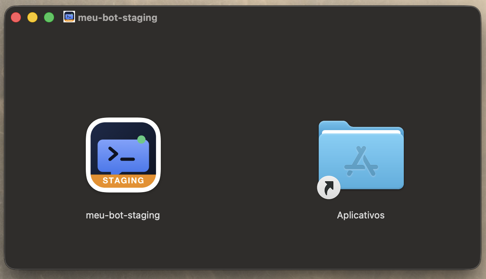

# meu-bot

**Um agente de IA que atende seus clientes no WhatsApp enquanto você trabalha.**

Ele roda no seu Mac, pensa com o Grok, da xAI, lê seu Gmail e usa o navegador por você. Você define o que ele pode
fazer, e ele pede confirmação antes de qualquer coisa importante.

  

<b>Baixe, arraste para Aplicativos e pronto.</b> 
O link de download está na descrição deste repositório, aqui ao lado. 👉

## O que ele faz

- 💬 **Atende no WhatsApp**, no seu número e com o seu jeito de falar, e te chama quando a conversa precisa de você.
- 📧 **Organiza o Gmail**: busca, lê e resume, e só apaga com a sua confirmação.
- 🌐 **Usa o navegador por você**, ao vivo numa janela do app, e nunca compra, paga ou envia formulário sem você.
- 🧠 **Aprende o seu processo**: o que deu certo uma vez vira passo a passo para a próxima.

## Por que testar agora

Esta é a fase de ensaio: **beta testers usam tudo de graça** e contam para a gente o que funcionou. Precisa de um Mac
com chip Apple (M1 ou mais novo). O app se atualiza sozinho e cada atualização tem a assinatura conferida antes de
instalar.

---

Código aberto. Para rodar e desenvolver: [docs/DESENVOLVIMENTO.md](docs/DESENVOLVIMENTO.md).
