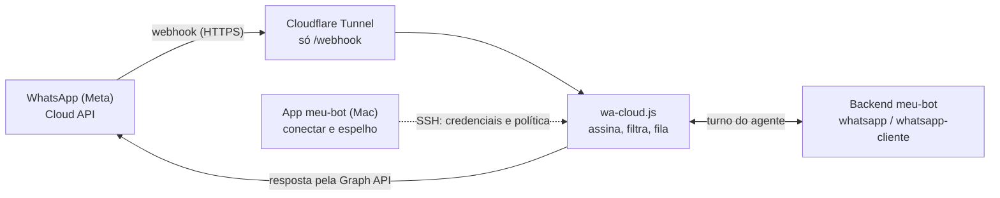

# Backlog: WhatsApp pela API oficial (Cloud API da Meta)

Branch `feat/whatsapp-api-oficial` (no GitHub). Nada disto está em staging nem em produção. Trabalhe num worktree
próprio a partir do branch, não na pasta principal `~/Desktop/meu-bot` (outras sessões usam ela).

## Por quê

OpenClaw, Hermes e PicoClaw conectam o WhatsApp pelo protocolo do WhatsApp Web (cliente não oficial), e dezenas de
números saem pelo mesmo IP da VPS: risco de bloqueio. Decisões do usuário (28 out):
- **API oficial como 4ª opção** em "Escolha o agente"; os outros três continuam iguais (instalador híbrido).
- **Cada cliente usa a própria conta da Meta** (app + número do Meta Business dele); cola token e IDs no meu-bot.
- **Webhook por Cloudflare Tunnel** na máquina (endereço HTTPS só para o receptor; nenhuma porta aberta).
- **Faz parte do Pro.**
- Para quem continuar nos não oficiais: opção de a conexão sair **pelo IP do Mac da pessoa** (fase 3).

Plano completo: `~/.claude/plans/pode-planejar-essa-melhoria-floofy-octopus.md` (no Mac do usuário).

## Caminho de uma mensagem

Só o receptor `wa-cloud.js` é novo e fica exposto, e só pelo caminho `/webhook`; o backend e o agente são os de hoje.

## Itens e status

| # | Item | Critério de aceite | Depende de | Status |
|---|---|---|---|---|
| 1 | Túnel Cloudflare por máquina, criado pelo admin | `wa-<máquina>.<domínio>` responde só em `/webhook`; `/v1/*` inacessível de fora; token só no Keychain do admin | domínio + token da Cloudflare | bloqueado |
| 2 | Teste de ponta a ponta com a Meta | mensagem real → resposta no WhatsApp; espelho no app e no admin; "só eu"/lista/pausa respeitados | item 1 + app da Meta | bloqueado |
| 3 | Acoplamentos que assumem OpenClaw (avisos ao dono, CRM, textos da tela) | aviso de "Mac novo" chega pela API oficial; resumo do CRM sai do receptor | item 2 | a fazer |
| 4 | Documentação no guia | `docs/guia/whatsapp.md` e `suporte-admin.md` explicam conectar, túnel, limites e depuração | itens 1 e 2 | a fazer |
| 5 | Fase 2: áudio na API oficial | áudio recebido vira texto; resposta em voz off/quando recebe/sempre | item 2 | a fazer |
| 6 | Fase 3: IP pelo Mac (não oficiais) | `curl ifconfig.me` pelo gateway mostra o IP da casa; Mac fechado = "esperando o Mac" | suporte a proxy no Hermes e PicoClaw | a fazer |
| 7 | Corrigir o PicoClaw ("quem responde" declarado, mas gravar falha) | cartões só aparecem se gravar funciona | — | a fazer |
| 8 | Publicar (staging → produção) | staging aprovado; produção do mesmo commit | itens 1 a 3, 9 e 10 | a fazer |
| 9 | Freio contra loop com outro bot em conversa direta | conversa em loop com outro bot pausa o contato sozinha e registra na auditoria | `LoopTracker` (branch `feat/rene-aproveitamentos`) | feito |
| 10 | Memória do dono no wa-cloud | atalho do dono ("anota…", "esquece…") responde sem gastar turno; turnos do dono levam o contexto da memória | `memoria.mjs` (branch `feat/rene-aproveitamentos`) | feito |

## Pré-requisitos do dono

- [ ] Cloudflare: informar o domínio que está na Cloudflare (endereços `wa-<máquina>.<domínio>`).
- [ ] Cloudflare: criar um token de API com Tunnel:Edit e DNS:Edit nesse domínio.
- [ ] Meta: criar um app em developers.facebook.com (tipo Business, produto WhatsApp), que vem com um número de teste gratuito.
- [ ] Meta: no Meta Business, criar um usuário de sistema e gerar um token permanente com `whatsapp_business_messaging` e `whatsapp_business_management`.

## Feito (7 commits, 694 testes passando)

| Commit | O quê |
|---|---|
| `5ef943c` | `backend-colima/wa-cloud-core.js` (puro) e `wa-cloud.js` (serviço só em 127.0.0.1): GET de verificação, HMAC-SHA256 do corpo bruto, 200 na hora + fila por contato, duplicatas, política self/open/list + pausados, chama o backend (`model whatsapp` para o dono, `whatsapp-cliente` para os outros, `X-Conversation-Id wa-<n>`, Seen para o `--resume`), envia pela Graph API, histórico `~/.local/share/meu-bot/wa-cloud/<n>.jsonl`, sem Pro não responde. |
| `bc1d5e6` | `server.js` aceita `WA_CLOUD_KEY` (papel do agente) e o perfil `whatsapp-cliente`; `nivel-ferramentas.js` `BLOQUEIO_CLIENTE` (sem comandos, escrita, leitura de arquivos nem WebFetch). |
| `a1fe106` | `install-wa-cloud.sh` / `uninstall-wa-cloud.sh` / `meu-bot-wa-cloud.service`; `install.sh` copia o receptor e o reinicia se ligado; `BUNDLE_FILES`; backend `VERSION 1.4.0`. |
| `7117674` | App: `Gateway`/`WhatsappAgente` com `"cloud-api"`, capacidade `credencial` (≠ `parear`), `usa_cloud()` e `usa_hermes` não pega mais o cloud-api; `whatsapp-cloud-core.ts` (status sem vazar segredo, `cloudApiStatus`, `politicaCloud`). |
| `b21ade4` | `whatsapp:cloud-conectar` (Pro): confere token + ID na Graph API deste Mac, liga o receptor, grava `~/.config/meu-bot/wa-cloud.env` (0600, base64 pelo stdin) e o dono; desconectar, trocar de agente e "quem responde". |
| `d534b4d` | Tela: cartão "API oficial (Meta)"; `GuideStep.variante` + `passoPara` (o QR vira "Conectar à Meta", formulário `renderCloudConectar`, token de verificação com Copiar; áudio conclui sozinho). |
| `62b4c2c` | Espelho: lista/conversa/limpar/pausar pelos jsonl do receptor (chaves `wa-cloud:<n>`). |

Testado na VM de teste (colima): instalou, ouviu só em 127.0.0.1:8090; sem Pro não chamou o agente; com Pro o agente
respondeu ("funcionou", 4,2 s) e o envio caiu no 401 da Graph com token falso. VM limpa depois (backend dela ficou 1.4.0).

## A fazer

### 1. Túnel público (Cloudflare) — bloqueado: precisa do usuário
- Ele precisa informar o **domínio na Cloudflare** e criar um **token de API com Tunnel:Edit e DNS:Edit**.
- O **meu-bot-admin** guarda o token só no Keychain (modelo `src/main/app/secrets.ts`) e, numa ação nova da página
  Suporte ("Preparar WhatsApp oficial"), cria o túnel da máquina: instala `cloudflared` como serviço (só saída),
  ingress **apenas** `wa-<máquina>.<domínio>/webhook → 127.0.0.1:<WA_CLOUD_PORT>` (o resto 404), cria o DNS, e mostra
  o endereço. Auditoria `whatsapp.oficial.preparar`. Várias contas na mesma VM: hostname e porta por conta.
- Depois, `renderCloudConectar` mostra o endereço real em vez de "o suporte prepara".
- Verificar de fora: `curl https://wa-<m>.<dom>/webhook?hub.mode=subscribe&hub.verify_token=…&hub.challenge=1`
  responde 1; `/v1/*` do backend continua inacessível.

### 2. Teste de ponta a ponta com a Meta — precisa do usuário
App de desenvolvedor em developers.facebook.com (Business + WhatsApp), com o número de teste gratuito. Conferir:
resposta do agente no WhatsApp; espelho no app e no admin; "só eu"/lista/pausa; contato desconhecido não lê arquivos.

### 3. Acoplamentos que ainda assumem OpenClaw
- `backend-colima/server.js` `sendWhatsappSelf` (avisos de segurança ao dono via `openclaw message send`): no
  cloud-api enviar pelo receptor; fora da janela de 24 h só com template aprovado (ou não envia; avisar).
- `backend-colima/crm/crm-job.mjs` lê `chat.history` do OpenClaw: ler o jsonl do receptor.
- Conferir telas que ainda comparam o nome do gateway: `waChannelPrompt`, `waAgentPrompt`, rótulo `via` em
  `paintWhatsapp` (`src/renderer/whatsapp/agente-whatsapp.ts`), `hostProbe.ts` (detecção do gateway no probe).

### 4. Documentação
Seção em `docs/guia/whatsapp.md` (receptor, credenciais, capacidades, segurança do cliente) e o túnel em
`docs/guia/suporte-admin.md`.

### 5. Fase 2 — áudio na API oficial
Ouvir: baixar `/media/<id>` com o token e usar `meu-bot-transcrever` (`install-transcricao.sh` hoje sai com 2 sem
OpenClaw). Responder em voz: `meu-bot-falar` (WAV) → ogg/opus (ffmpeg) → upload `/media` → `type: audio`; ligar
`capacidades.audio` e tirar a variante do passo de áudio.

### 6. Fase 3 — IP pelo Mac (só OpenClaw/Hermes/PicoClaw, opcional, desligado por padrão)
Proxy HTTP CONNECT no app + `ssh -R` no túnel que o app já mantém (`src/main/maquina/tunnel.ts`); drop-in da unidade
do gateway com `HTTPS_PROXY` (o OpenClaw documenta suporte: `docs/channels/whatsapp.md:141` na instalação). Verificar
Hermes (Baileys) e PicoClaw (whatsmeow). Mac desligado = WhatsApp desconectado (não cair para o IP da VPS); status
"esperando o Mac de <pessoa>".

### 7. Corrigir o PicoClaw
`capacidadesDe` declara `politicaDm: true` para o PicoClaw, mas `setDmPolicy` lança erro e o `PAIR_SCRIPT` não o
reconhece: os cartões de "quem responde" aparecem e falham ao clicar. Ou implementar a gravação
(`self_chat_only`/`allow_from` no `~/.picoclaw/config.json`) ou desligar a capacidade até lá.

### 8. Publicar
Juntar o branch na `main`/branch de release, `release:staging`, teste do usuário, `release` (backend 1.4.0 entra;
o `release.mjs` exige versão subida nos componentes alterados).

### 9. Freio contra loop (feito, 28 out)
O wa-cloud não tem freio contra outro bot respondendo em conversa direta. Reaproveitar o `LoopTracker` de
`backend-colima/guarda/regras.mjs` (puro; `received`/`sending` por conversa), hoje no branch
`feat/rene-aproveitamentos` (commit `44fcd0a`): chamar no `tratar()` ao receber e antes de enviar, e quando der loop
pausar o contato (`cloudPausarSh`, mesma lista do wa-cloud.json) e registrar. Em OpenClaw esse é o papel da guarda.

### 10. Memória do dono (feito, 28 out)
`backend-colima/guarda/memoria.mjs` (puro, ESM, mesmo branch) tem `atalho(texto)` e `aplicar(arquivo, atalho)`, que
gravam `~/.local/share/meu-bot/memoria-dono.md`, e `contexto(arquivo)` para o prompt. No papel `dono`, o wa-cloud
responde o atalho direto (sem turno do agente) e põe `contexto()` no prompt dos turnos do dono. É o mesmo arquivo que
a guarda usa no OpenClaw. Atenção: `wa-cloud.js` é CommonJS e `memoria.mjs` é ESM (`import()` dinâmico ou converter).

Como ficou: o pacote do backend leva `guarda/regras.mjs` e `guarda/memoria.mjs` (o `install.sh` põe em `./guarda/`
ao lado do `wa-cloud.js`, que os carrega com `import()`; sem eles, segue sem freio e sem memória). Freio só com quem
não é o dono: o loop pausa o contato no wa-cloud.json, não envia a resposta que fecha o loop e registra
`whatsapp.pausa-automatica`. Memória: o atalho do dono é respondido direto pelo receptor (sem turno); os turnos do dono
levam `contexto()` como mensagem de sistema (mudar a memória começa outra sessão no backend). Testes em
`scripts/tests/wa-cloud.test.mjs`. Mudar `regras.mjs`/`memoria.mjs` agora pede subir a versão do backend e da guarda.

### Merge com `feat/rene-aproveitamentos` (feito, 28 out)
Juntado no branch: backend `VERSION` 1.6.0 (acima de 1.4.0 e 1.5.0), listas unidas.
- `backend-colima/VERSION`: lá 1.3.0, aqui 1.4.0; quem juntar por último fica com a maior e sobe de novo se precisar.
- `BUNDLE_FILES` (`src/main/maquina/backend-bundle-core.ts`) e a linha `cp` do `install.sh` mudam nos dois: conflito
  simples, juntar os nomes.

## Limites da API oficial

- **Janela de 24 h:** o agente só fala livremente com quem escreveu nas últimas 24 h; fora disso, só por modelo
  (template) aprovado pela Meta. Afeta avisos ao dono e qualquer mensagem que o agente inicie.
- **Custo:** a Meta cobra por conversa iniciada pela empresa; o cliente paga direto à Meta.
- **Sem grupos:** a Cloud API não atende grupos comuns do WhatsApp (`capacidades.grupos = false`; a tela avisa).
- **Número dedicado:** o número da API oficial não pode estar em uso no app do WhatsApp; costuma ser um número novo.
- **IP pelo Mac** reduz a suspeita por IP compartilhado, mas não o risco de cliente não oficial, e depende do Mac ligado.
- Fora do escopo agora: Tech Provider com Embedded Signup (um app só do dono), grupos e modelos de marketing.

## Roteiro de teste de ponta a ponta

Sempre numa máquina de teste e com o número de teste da Meta, nunca na de um cliente.

1. Atualizar o backend da máquina de teste para 1.4.0 (do branch).
2. No admin, "Preparar WhatsApp oficial": o endereço público responde só em `/webhook`.
3. No app, tutorial "Conectar o WhatsApp": escolher "API oficial (Meta)" e colar as credenciais; aparecem o número
   confirmado e o token de verificação.
4. Na Meta: configurar o webhook com o endereço e o token e assinar `messages`; o status vai a "conectado".
5. Mensagem do WhatsApp pessoal do dono: o agente responde; com "só eu", outro número não recebe resposta.
6. "Todo mundo" + outro celular: o agente responde, mas recusa ler arquivos ou rodar comandos.
7. Pausar o contato, limpar a conversa e conferir no espelho do app e do admin.
8. Pro vencido na máquina de teste: o agente para de responder e o app mostra o bloqueio.

## Cuidados
- Nunca pôr `HOST=0.0.0.0` no backend; o túnel aponta só para `/webhook` do receptor.
- O HMAC é sobre o Buffer bruto (reserializar o JSON quebra).
- Segredos só no `wa-cloud.env` (0600); o status e a tela nunca recebem o valor.
- Sem Pro em vigor o receptor não responde (`licenca.proOk`).
